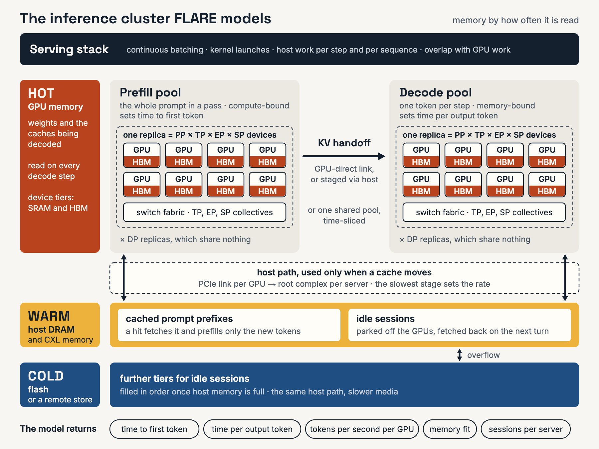
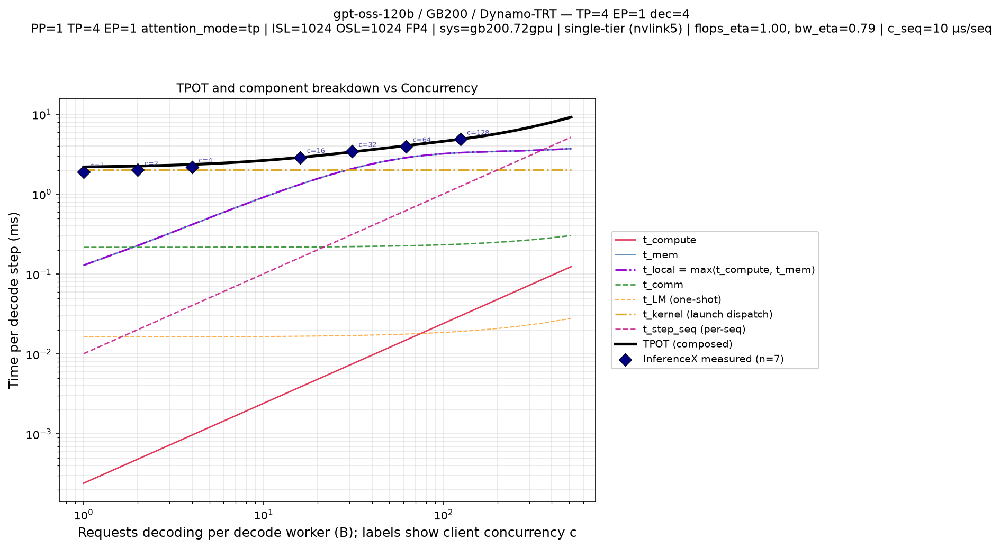
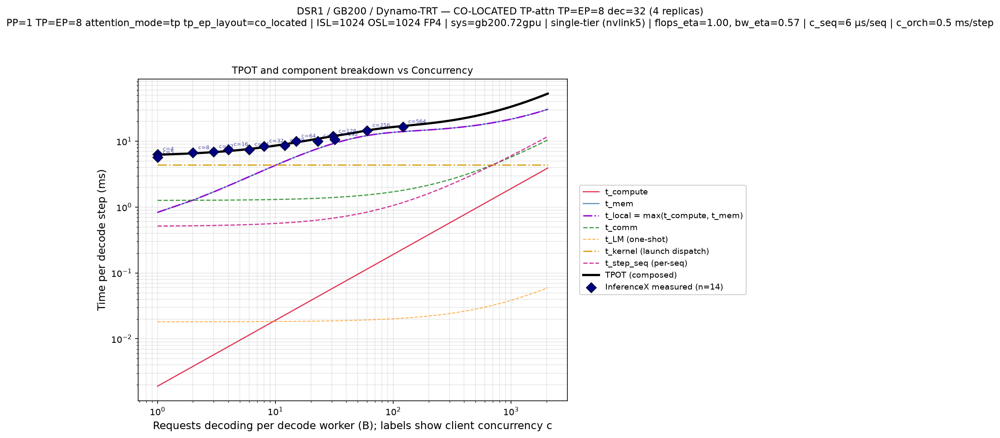
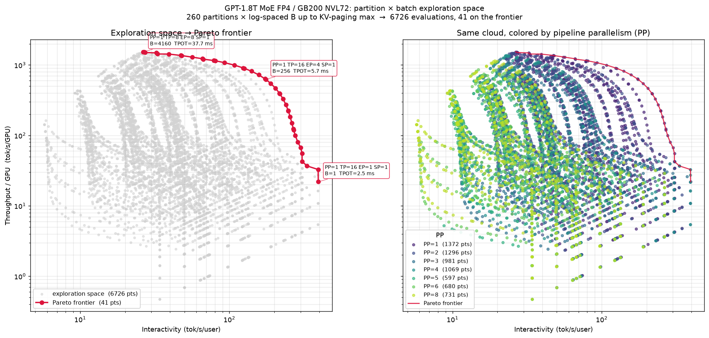
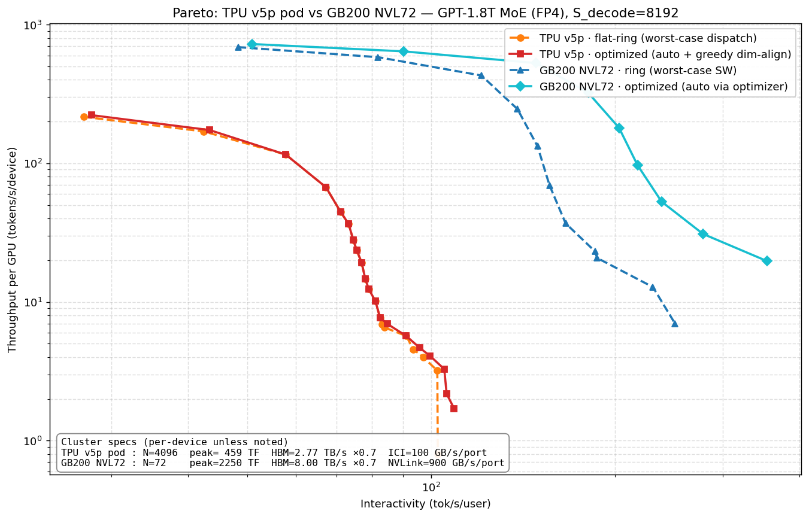

<p align="center">
  
</p>

# FLARE — Fast LLM Analytical Roofline Explorer

FLARE is a lightweight, first-principles analytical framework for large-language-model inference performance modeling. It predicts latency, throughput, and memory footprint of LLM inference on a given cluster *before* you build or rent it — from JSON descriptions of the model, the hardware, the parallelism layout, the workload, and the serving stack.

A five-stage roofline pipeline (memory → FLOPs → traffic → comm → latency) extended with prefill, end-to-end metric assembly, KV paging, chunked prefill, disaggregated prefill/decode pools, and key-value (KV) caches kept outside GPU memory — in host DRAM, Compute Express Link (CXL) memory and on flash. Composable pure functions over typed dataclasses — no global state.

**Four-pillar composition** (`model × system × partition × framework`), parameterized by a workload point (sequence length, batch size). The split keeps "which deployment shape" (partition) cleanly separated from "which serving stack runs it" (framework), so a single (model, system, partition) can be evaluated under multiple stacks (TRT-LLM, Dynamo+TRT, SGLang, vLLM, …) by swapping just the framework JSON.

This README is a navigation guide; the methodology is published as the [Decode Modeling book](https://spicemonkey.github.io/flare-llm/) (see **Tutorial** below), starting with [decode](https://spicemonkey.github.io/flare-llm/decode.html); the end-to-end layer is in [phase and memory disaggregation](https://spicemonkey.github.io/flare-llm/disaggregation.html).

**Overview slides:** [`documentation/flare_overview_slides.pdf`](documentation/flare_overview_slides.pdf) — an introductory slide deck on what FLARE models and what it leaves out: one decode step as a roofline, splitting a model across devices, software overhead, prefill and decode pools, caches in host memory and on flash, the check against InferenceX™ measurements, and a Pareto sweep as an example of exploring an architecture.

**Tutorial:** [**Decode Modeling**](https://spicemonkey.github.io/flare-llm/) — a walkthrough of the decode-phase derivation (decode + attention + memory hierarchy + 3D-stacked DRAM) and the serving layer above it (KV cache management, framework overhead, SLO feasibility, phase and memory disaggregation), with a pointer to the upstream collective-communication tutorial.

**API reference:** [`documentation/api/`](documentation/api/) — generated reference for the public `llm_perf` classes and functions (specs, calculators, core models, loaders, utilities).

---

## Cluster Architecture



A disaggregated prefill/decode pipeline with a distributed KV cache. Each device exposes an ordered list of memory tiers, so SRAM-augmented architectures (Groq LPU, d-Matrix Corsair) and conventional HBM-only GPUs share one model. Collective traffic crosses one or more hierarchical fabric tiers; in-network reduction is engaged where the fabric advertises capability and the framework opts in. The KV-transfer interconnect between prefill and decode clusters folds into TTFT in disaggregated mode. Memory is modeled in three classes by how often it is read: *hot* memory is GPU memory, read on every decode step; *warm* memory is host DRAM and CXL memory, which holds caches that are not being decoded and is read only when a cache moves; *cold* storage is flash or a remote store, further tiers behind the same host path.

---

## What's Supported

| Layer | Variants | Doc |
|---|---|---|
| **Attention** | MHA, GQA, MQA, MLA (DeepSeek) | [attention](https://spicemonkey.github.io/flare-llm/attention.html) |
| **Memory hierarchy** | single-tier HBM, multi-tier HBM + SRAM, hypothetical 3D-stacked | [sram](https://spicemonkey.github.io/flare-llm/sram.html), [dram3d](https://spicemonkey.github.io/flare-llm/dram3d.html) |
| **Collectives** | ring / tree (DBT) / Rabenseifner / PAT / hierarchical / torus / INC (NVLS, Quantum SHARP, hw_a2a) | [collectives](https://spicemonkey.github.io/flare-llm/collective_comm.html) |
| **Fabric topology** | crossbar (NVSwitch / IB / PCIe), torus (TPU ICI), full mesh, k-D mesh | [collectives](https://spicemonkey.github.io/flare-llm/collective_comm.html) |
| **Parallelism axes** | DP / PP / TP / EP / SP, with orthogonal or co-located TP+EP layout | [decode](https://spicemonkey.github.io/flare-llm/decode.html) |
| **Serving stacks** | 7 calibrated framework JSONs: `default`, `trt`, `dynamo_trt`, `dynamo_sglang`, `dynamo_vllm`, `sglang`, `vllm` | [framework](https://spicemonkey.github.io/flare-llm/framework.html) |
| **KV handoff** | co-located matched, co-located repack, disaggregated transfer | [kv](https://spicemonkey.github.io/flare-llm/kv.html) |
| **Prefill and decode pools** | shared replica under prefill interference, two-pool sizing, shared vs. split under latency targets, GPU-direct or host-staged handoff | [disaggregation](https://spicemonkey.github.io/flare-llm/disaggregation.html) |
| **Warm and cold memory** | host DRAM, CXL, flash and remote-store tiers behind a host path; prefix reuse with a fetch-vs-recompute rule; idle sessions parked across tiers | [disaggregation](https://spicemonkey.github.io/flare-llm/disaggregation.html) |
| **SLO feasibility** | floor checks, TPOT bound on B, TTFT bound on shape, batch window, goodput-optimal partition sweep | [slo](https://spicemonkey.github.io/flare-llm/slo.html) |

---

## Validation — Predicted vs. Measured TPOT

FLARE's decode predictions are cross-validated against measured production-stack Time-Per-Output-Token (TPOT) from the [InferenceX™](https://github.com/SemiAnalysisAI/InferenceX) public benchmark dataset (SemiAnalysis LLC, Apache-2.0; snapshot vendored under [`benchmark/inferenceX/`](benchmark/inferenceX/), fetched 2026-05-09). Each published driver under [`benchmark/validate/`](benchmark/validate/) pins one (model, hardware, framework) cut, sweeps concurrency *B*, and overlays the model's cost-component breakdown on the measured scatter — so the plot shows not just *whether* the prediction lands, but *which primitive* sets the floor at each operating point.

Calibration is per setup: each (model, hardware, serving stack) has its own few constants, fitted on its own measured points. Two things belong to the serving stack and are shared by both setups below: the per-kernel launch time (4 µs for Dynamo+TRT-LLM) and the rule that host work adds to the GPU step instead of hiding behind it. Up to four constants are fitted per setup: *bw_eta*, which multiplies the HBM bandwidth on top of the 0.7 sustained-to-nameplate fraction the GB200 system spec already carries (so the two setups run at 0.48× and 0.43× nameplate); *c*<sub>seq</sub>, the per-sequence host-side serving work (5.5 and 4.8 µs); *c*<sub>orch</sub>, a per-step host floor that does not depend on batch (none and 0.62 ms); and the share of the kernel-launch time that overlaps GPU work (0.55 and 0.35). Treat all four as fitted residuals, not as measured hardware constants: constants fitted on one model do not carry over to another model on the same hardware and stack. Everything else is first-principles. The model's batch is that of one replica, so a measured point's client concurrency is divided by its number of decode workers. Each example below is reproducible with the single command shown.

### Small MoE — gpt-oss-120b on GB200



```bash
python benchmark/validate/gpt_oss_120b_gb200_dynamo_trt.py
```

120B MoE at FP4, TP=4 EP=1 on GB200 NVL72 under Dynamo+TRT-LLM, ISL/OSL = 1024/1024, one decode worker. **Mean absolute error (MAE) 5.6% over 7 measured points (B = 1…128).** The interesting feature is the nearly flat left half: through *B* ≈ 16 the deployment is *kernel-dispatch-bound* — the ~2.0 ms *t*<sub>kernel</sub> budget exceeds the GPU work, so TPOT barely moves with batch. A fitted 55% of that budget overlaps GPU work, which turns the corner where weight traffic takes over into the gradual bend the measured points show. This setup has one cut of seven points, so its four constants have no held-out check; the largest error is 15.7%, at *B* = 1.

### Large MoE — DeepSeek-R1 on GB200 NVL72



```bash
python benchmark/validate/dsr1_gb200_dynamo_trt.py --cut colo_tp_attn
```

671B / 37B-active MoE + MLA at FP4 on GB200 NVL72 under Dynamo+TRT-LLM, in the **co-located TP+EP layout** (TP = EP = 8, TP attention, 4 decode workers of 8 GPUs). **MAE 4.7% over 14 measured points spanning client concurrency 4…564**, which is 1…141 in-flight requests per worker — the widest single-cut coverage in the dataset, crossing the dispatch-bound plateau and the memory-bound ramp. The plateau is the kernel-launch budget, of which a fitted share overlaps GPU work, plus a 0.62 ms per-step host floor. Calibration is per setup: four constants are fitted on the driver's eight DeepSeek-R1 cuts together (43 points, TP = EP of 8, 16 and 32 and TP = 36), which come to 12.9%; with one cut held out of the fit, that cut scores 17.3% on average.

> Benchmark data © 2026 SemiAnalysis LLC, licensed under Apache-2.0. This is an **unofficial** analysis derived from the InferenceX public API — the canonical source is [SemiAnalysisAI/InferenceX](https://github.com/SemiAnalysisAI/InferenceX). See [`benchmark/inferenceX/NOTICE`](benchmark/inferenceX/NOTICE).

---

## Repository Layout

```
.
├── README.md
├── notebooks/         — quickstart + Pareto-frontier case studies
├── benchmark/
│   ├── inferenceX/    — vendored InferenceX measurement snapshot
│   └── validate/      — per-cut predicted-vs-measured TPOT drivers
├── documentation/
│   ├── api/           — generated API reference
│   └── flare_overview_slides.pdf   — introductory slide deck
└── llm_perf/
    ├── calculators/   — InferenceCalculator, PrefillCalculator, E2ECalculator
    ├── core/          — memory_model, decode_model, prefill_model, the end-to-end layer
    │                    (pool_model, kv_transfer, kv_reuse, kv_store_model, …) + primitives
    │   └── primitives/collective_cost.py   — mirrored from spiceMonkey/collective-comm
    ├── database/      — model / system / tuner / framework JSON specs
    ├── specs/         — typed dataclasses (LlmModelSpec, SystemSpec, …)
    └── io/, utils/    — loaders, equations, HF adapter, DRAM3D helper
```

---

## Quickstart

```bash
python -m venv .llm_perf
source .llm_perf/bin/activate
pip install jupyter matplotlib numpy
jupyter notebook notebooks/quickstart.ipynb
```

### Programmatic usage

```python
from llm_perf import InferenceCalculator, PartitionSpec
from llm_perf.calculators.prefill_calculator import PrefillCalculator
from llm_perf.calculators.e2e_calculator import E2ECalculator
from llm_perf.core.collective_algo_opt import optimize_collective_algorithms
from llm_perf.io import (
    load_model_from_db, load_system_from_db, load_tuner_from_db, load_framework_from_db,
)
from llm_perf.specs.overhead_spec import OverheadSpec
from llm_perf.specs.disagg_spec import DisaggSpec

model     = load_model_from_db("gpt_1_8t_moe")
system    = load_system_from_db("gb200.72gpu")
tuner     = load_tuner_from_db("gpt_1_8t_moe.tuner")
partition = PartitionSpec(PP=1, TP=8, EP=8, SP=1)   # co-located TP+EP, as dynamo_trt expects
framework = load_framework_from_db("dynamo_trt")
tuner.S_input, tuner.S_decode, tuner.B_decode = 8192, 8192, 64

framework = optimize_collective_algorithms(model, partition, system, tuner, framework)

decode   = InferenceCalculator(model, system, partition, tuner, framework).run()
prefill  = PrefillCalculator(model, system, partition, tuner, framework).run()
e2e      = E2ECalculator(
    decode, prefill,
    overhead=OverheadSpec(t_graph_us=100.0),
    disagg=DisaggSpec(),
    model=model, system=system, partition=partition, tuner=tuner,
).run()

print(f"TTFT       = {e2e.TTFT*1e3:.1f} ms")
print(f"TPOT       = {e2e.TPOT*1e3:.2f} ms")
print(f"tok/s/GPU  = {e2e.throughput_per_gpu:.1f}")
```

`framework` is optional — omit for `FrameworkSpec.default()` (pure roofline). Swap framework JSONs to compare stacks on the same (model, system, partition, tuner).

### Warm and cold memory

The end-to-end layer also prices key-value (KV) caches that are kept outside GPU memory: a reusable prompt prefix fetched from host memory instead of being prefilled again, and idle sessions parked in host DRAM and then on flash. A system JSON with a `host` block lists the tiers (`h200.8gpu`, `h100.8gpu` and `b200.8gpu` carry one).

```python
from llm_perf.specs.workload_spec import WorkloadSpec
from llm_perf.specs.kv_offload_spec import KVOffloadSpec

model     = load_model_from_db("llama3.1_70b")
system    = load_system_from_db("h200.8gpu")          # host block: DRAM and flash tiers behind the host path
tuner     = load_tuner_from_db("large_dense.tuner")
partition = PartitionSpec(PP=1, TP=8, EP=1, SP=1)
framework = load_framework_from_db("trt")
tuner.S_input, tuner.S_decode, tuner.B_decode = 32768, 36864, 16
framework = optimize_collective_algorithms(model, partition, system, tuner, framework)

workload = WorkloadSpec(output_tokens=1024, prefix_hit_rate=0.8, prefix_tokens=30000, idle_fraction=0.9)
offload  = KVOffloadSpec(prefix_tier="dram", idle_tier="dram", overflow_tiers=("flash",))

decode  = InferenceCalculator(model, system, partition, tuner, framework).run()
prefill = PrefillCalculator(model, system, partition, tuner, framework).run()
e2e     = E2ECalculator(
    decode, prefill, overhead=OverheadSpec(), disagg=DisaggSpec(),
    model=model, system=system, partition=partition, tuner=tuner,
    framework=framework, workload=workload, offload=offload,
).run()

print(f"TTFT, whole prompt prefilled = {e2e.TTFT:.2f} s")            # 1.26 s
print(f"TTFT, prefix fetched         = {e2e.TTFT_hit:.2f} s")        # 0.51 s
print(f"TTFT, expected at 80% hits   = {e2e.TTFT_expected:.2f} s")   # 0.66 s
print(f"sessions per server          = {e2e.warm.N_sessions:.0f}")   # 800, against 80 held in GPU memory
print(f"parked in DRAM, on flash     = {[round(n) for n in e2e.warm.N_parked_by_tier]}")   # [165, 555]
```

Hot memory (GPU memory) is read on every decode step and is modeled by the decode and prefill calculators; warm memory (host DRAM, CXL) and cold storage (flash, a remote store) are read only when a cache moves, so they change time to first token (TTFT), prefill work and sessions per server, and never the decode step. Every move of a cache — a handoff between pools, a fetch, a store, a resume — is one transfer function over a path of stages: stage latencies add and the slowest stage sets the rate. The prefix hit rate and the idle fraction are inputs, not predictions, and there is no queue in the model. Unlike decode TPOT, these end-to-end results are not validated against measurement: no consistent public TTFT data is available. Derivation: [phase and memory disaggregation](https://spicemonkey.github.io/flare-llm/disaggregation.html).

---

## Case Study — `notebooks/pareto_basic.ipynb`



Enumerates every valid pipeline / tensor / expert / sequence parallelism partition `(PP, TP, EP, SP)`, sweeps the batch `B` from 1 to the KV-paging max, and extracts the upper-right envelope in (interactivity, throughput/GPU) space. At baseline GB200 NVL72 with `PP_MAX = 8`: 260 valid partitions and 6,880 evaluations → 40 frontier points.

Three partitions carry almost all of it, and all three are single-stage. The interactive end is `PP=1 TP=16 EP=1`, capped at 395 tok/s/user by the kernel-launch budget of the 120 layers; that assumes the all-reduce runs in the NVLink switch, which the default framework enables (with software collectives the ceiling is 355 tok/s/user with a tree and 251 with a ring — the second case study). From 65 to 307 tok/s/user the envelope is `PP=1 TP=16 EP=4`: a replica is then four groups of sixteen devices, each group serving its own quarter of the batch, and spreading the experts over all 64 devices cuts the expert weights each device reads per step from 56 GB to 17 GB. Below 65 tok/s/user it is `PP=1 TP=8 EP=8`, peaking at 1,539 tok/s/GPU. Pipeline depth buys batch, not speed: a token crosses every stage, so a pipeline of depth `PP` at batch `B` lands where `PP=1` at batch `B/PP` does, while holding `1/PP` of the weights and KV cache per device. Expert parallelism relieves the same memory limit without the extra stages, so depth barely appears.

Workload: GPT-1.8T MoE @ FP4 on GB200 NVL72.

---

## Case Study — `notebooks/pareto_tpu_vs_gb200.ipynb`



Two fabrics with opposite design points, same workload: GPT-1.8T MoE @ FP4, `S_decode = 8192`, batch up to 256. A TPU v5p slice (4096 chips, 3D torus 16³, 459 TF and 2.77 TB/s HBM per chip, 100 GB/s/port Inter-Chip Interconnect) against a GB200 NVL72 (72 GPUs, single-tier NVLink crossbar, 2250 TF and 8 TB/s HBM per GPU, 900 GB/s/port). Both chips are given the same 0.7 sustained-to-nameplate memory-bandwidth fraction; the GB200 value is fitted to measured runs and the TPU has no measurement behind it, so the notebook exposes it as one knob. Any replica that fits a system is admitted, and devices left over after the last whole replica idle and still count in throughput per device. Both axes are per-device or per-user, so the 4096-vs-72 device gap doesn't distort the comparison — but aggregate throughput is not shown, and it scales with cluster size.

| Fabric | Valid partitions | Peak throughput/device | Peak interactivity | Winner at peak throughput |
|---|---|---|---|---|
| TPU v5p slice | 1,066 | 222 tok/s/device | 109 tok/s/user | `PP=1 TP=8 EP=4 B=256` |
| GB200 NVL72 | 260 | 724 tok/s/device | 355 tok/s/user | `PP=1 TP=16 EP=1 B=256` |

The rack is ahead at every operating point: 3.3× the throughput per device at the batch-heavy end, 6.3× at 50 tok/s/user, 9.5× at 60, and past 110 tok/s/user the pod has no operating point at all. Two things separate them. Memory bandwidth per chip is 2.9× higher on GB200, and decode on a model this size is bound by reading weights. And the smaller, slower-linked chip needs wider groups: the GB200 frontier is `TP=16` with 1 to 4 expert-parallel groups over 900 GB/s links, the TPU frontier `TP=8` with 4 to 16 groups — replicas of 32 to 128 chips — over 100 GB/s links. Communication takes 23–49% of stage time along the TPU frontier against 12–37% along the GB200 one. At nameplate TPU memory bandwidth the TPU peak rises to 294 tok/s/device and the ordering is unchanged.

Each fabric is also swept under two collective-algorithm variants — ring everywhere versus the per-collective optimizer (double binary tree, DBT, on the crossbar; dimension-decomposed torus routing on the pod). **On GB200 the optimizer changes which partition wins**: under ring the frontier is built from `TP=8`, because a ring all-reduce over 16 ranks costs too much latency; the pipelined DBT makes `TP=16` affordable and lifts peak throughput from 688 to 724 tok/s/device and top interactivity from 251 to 355 tok/s/user. On the pod the gain is small (216 to 222 tok/s/device at the peak, 103 to 109 tok/s/user at the tail): its winning groups are small enough that a flat ring and a dimension-by-dimension walk cost nearly the same. The lesson generalizes: collective-algorithm tuning pays in proportion to the communication share, and that share is set by how wide the groups must be before the model fits.

---

## Utilities

- **HuggingFace Adapter** — converts any HF `config.json` (incl. MoE / GQA) into the `llm_perf.model` schema. See [`utils/hf_model_adapter.py`](llm_perf/utils/hf_model_adapter.py).
- **DRAM3D Bandwidth Calculator** — derives HBM bandwidth from die-interface parameters to evaluate future memory classes (HBM3E / HBM4 / HBM4E). See [`utils/dram3d.py`](llm_perf/utils/dram3d.py) and the [3D-stacked DRAM bandwidth](https://spicemonkey.github.io/flare-llm/dram3d.html) chapter.

---

## Contributing

Open issues or PRs for new spec types, adapters, or analytical improvements. Keep JSON schemas backward compatible. Run the quickstart notebook after large changes.

---

## License

MIT — see [LICENSE](LICENSE).
